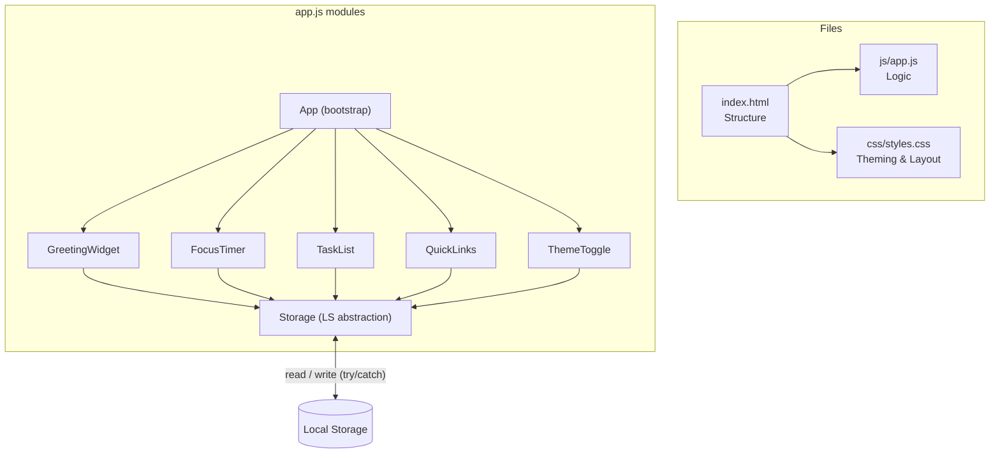
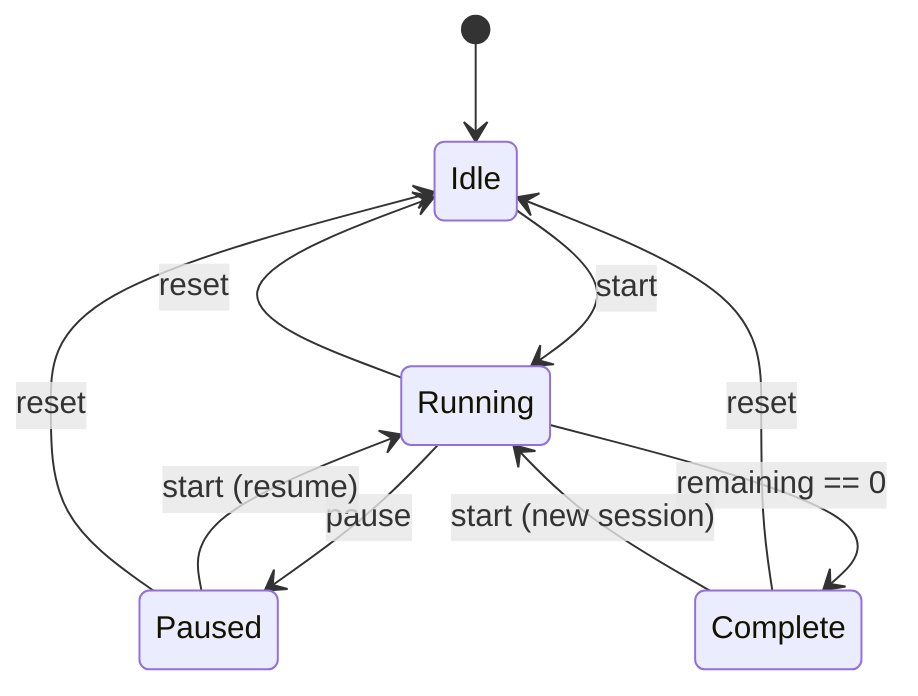
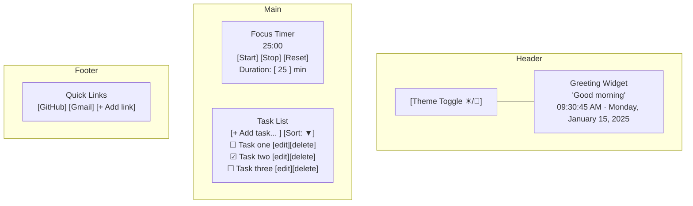

# Design Document

## Overview

The Todo List Life Dashboard is a client-side single-page web application that functions as a personal productivity dashboard. It combines four interactive widgets — a time-of-day greeting clock, a Pomodoro focus timer, a to-do list, and quick website links — with a light/dark theme toggle. All data persists in the browser's Local Storage, so the application requires no backend server.

The design prioritizes simplicity and framework independence: the entire application is three files — one HTML file at the project root for structure, one CSS file in `css/` for theming and layout, and one JavaScript file in `js/` for all logic. JavaScript is organized into self-contained component modules within the single file, each owning its state, DOM rendering, and persistence concerns. A thin `Storage` abstraction wraps Local Storage so that quota and availability failures are handled uniformly across all widgets.

This document defines the architecture, component interfaces, data models, local storage schema, theming approach, event-handling strategy, correctness properties, error handling, and testing strategy for the dashboard.

## Research Summary

The design relies on stable, well-established web platform features whose behavior has not changed recently, so no external research was required. Key technologies and how they inform the design:

- **Local Storage API**: A synchronous key-value store that holds strings, with a per-origin quota (typically 5–10 MB). Writes can throw `QuotaExceededError` when full and `SecurityError` when disabled (e.g., private browsing in some browsers). This drives the `Storage` abstraction that wraps all access in `try/catch` and returns success booleans, satisfying Requirement 14.3 and the persistence failure-handling criteria.
- **CSS Custom Properties (Variables)**: Defined on `:root` and overridden under a `[data-theme="dark"]` selector. Switching themes is a single attribute change on `document.documentElement`, so other widgets need no JavaScript re-render for theme changes. This is the basis for the Theme Toggle design.
- **`setInterval` / `requestAnimationFrame`**: A 1-second `setInterval` is appropriate for both the greeting clock and the focus timer because their display granularity is one second. No sub-second updates are required, so the cost is negligible and within the 100 ms responsiveness budget.
- **Event Delegation**: Attaching a single listener to a container and dispatching on `data-action` attributes handles dynamically created elements (tasks, links) without per-element listeners, keeping listener count low and updates fast.
- **`crypto.randomUUID()`**: Available in all target browsers (recent Chrome, Firefox, Edge, Safari) and provides collision-free IDs for tasks and links without a dependency.
- **URL validation**: The `URL` constructor parses URLs and exposes the `protocol` property, which cleanly validates the `http`/`https` scheme requirement and the presence of a hostname (domain).

## Architecture

The application follows a layered, component-based architecture. The presentation, styling, and logic concerns are separated into the three required files, and the logic file is internally organized into isolated modules using the revealing module pattern (IIFEs). Each widget module is self-contained: it manages its own in-memory state slice, renders its own DOM subtree, and persists through the shared `Storage` module.

### Layering

1. **Presentation Layer (`index.html`)**: Defines the semantic document structure — a header containing the theme toggle and greeting widget, a main region with the focus timer and task list, and a footer/aside region with quick links. HTML is static for the shell; dynamic content (task rows, link buttons) is generated by JavaScript.
2. **Styling Layer (`css/styles.css`)**: Provides layout (CSS Grid), theming via custom properties, and component styles. Light theme values are the default on `:root`; dark theme values are declared under `[data-theme="dark"]`.
3. **Logic Layer (`js/app.js`)**: Contains all behavior, organized into the modules described in Components and Interfaces. A bootstrap module initializes the others in dependency order after the DOM is ready.

### Architecture Diagram



### Key Architectural Decisions

- **Single file, multiple modules**: Requirement 16 mandates exactly one JavaScript file. The revealing module pattern keeps concerns separated without splitting files. Each module exposes only a small public interface and holds private state in closure scope.
- **Shared `Storage` abstraction**: Every widget persists through one `Storage` module rather than calling `localStorage` directly. This centralizes JSON (de)serialization and error handling, and makes the quota/availability failure path uniform (Requirements 8.3, 10.5, 14.3).
- **No cross-widget reactivity**: Widgets have no runtime dependencies on each other except theme, which is applied purely through a CSS attribute. This keeps each module independently testable and avoids a reactive framework.
- **Pure logic exposed for testing**: Pure functions (time formatting, greeting selection, validation, sorting) are attached to a small `Core` namespace object so property-based tests can call them directly without a DOM.

## Components and Interfaces

Each module exposes a minimal public interface. Internal helpers are private to the module. Public functions are written in `PascalCase.Module.method` style for clarity; the actual file attaches them to module objects.

### Storage

Wraps Local Storage with JSON serialization and failure-safe semantics. All other modules use it exclusively for persistence.

| Function | Description |
|----------|-------------|
| `Storage.isAvailable()` | Returns `true` if Local Storage can be read and written. Probes with a throwaway key. |
| `Storage.get(key, defaultValue)` | Reads and `JSON.parse`s the value at `key`. Returns `defaultValue` if the key is missing, the value is `null`, or parsing fails. |
| `Storage.set(key, value)` | `JSON.stringify`s `value` and writes it. Returns `true` on success, `false` if Local Storage is unavailable or the write throws. |
| `Storage.remove(key)` | Removes the key. Returns `true` on success. |

**Storage keys** (all namespaced with the `tld.` prefix):
- `tld.tasks` — JSON array of `Task` objects
- `tld.quickLinks` — JSON array of `QuickLink` objects
- `tld.pomodoroDuration` — JSON number (minutes)
- `tld.theme` — JSON string, either `"light"` or `"dark"`

### GreetingWidget

Displays the current local time, date, and a time-of-day greeting, updating every second.

| Function | Description |
|----------|-------------|
| `GreetingWidget.init(container)` | Caches DOM references within `container`, renders immediately, and starts a 1-second interval. |
| `GreetingWidget.stop()` | Clears the interval (used on teardown). |

Pure helpers (also on `Core` for testing):
- `Core.formatTime(date)` → `string` — 12-hour `hh:mm:ss AM/PM`.
- `Core.formatDate(date)` → `string` — `Weekday, Month Day, Year`.
- `Core.getGreeting(hour)` → `string` — returns the greeting for hour 0–23 per the ranges in Requirement 2.

### FocusTimer

A Pomodoro countdown with start, stop (pause), reset, and configurable duration.

| Function | Description |
|----------|-------------|
| `FocusTimer.init(container)` | Caches DOM references, loads saved duration (or default 25), renders, and wires control buttons. |
| `FocusTimer.start()` | Begins or resumes the countdown. If paused, resumes from retained remaining time. |
| `FocusTimer.pause()` | Pauses the countdown, retaining the remaining time. |
| `FocusTimer.reset()` | Stops the countdown and resets the display to the current duration. |
| `FocusTimer.setDuration(minutes)` | Validates and sets a new duration (1–120, whole minutes). On success, saves to Local Storage and updates the display. On failure, shows a rejection indication and retains the previous value. |

Internal state: `duration` (minutes), `remaining` (seconds), `isRunning` (bool), `isPaused` (bool), `intervalId`. Pure helper:
- `Core.computeRemaining(durationSeconds, elapsedSeconds)` → `number` — `max(0, durationSeconds - elapsedSeconds)`.

**Focus Timer state machine:**



### TaskList

Manages tasks with add, edit, toggle-complete, delete, and sort operations.

| Function | Description |
|----------|-------------|
| `TaskList.init(container)` | Caches references, loads saved tasks (or empty list), renders, and wires delegated events. |
| `TaskList.add(text)` | Validates `text`; if valid, appends a new incomplete task (preserving creation order), saves, and re-renders. |
| `TaskList.beginEdit(id)` | Switches the task row to an editable input. |
| `TaskList.saveEdit(id, newText)` | If `newText` is valid, updates text (preserving completion status and creation order), saves, and exits edit mode; otherwise retains the original text and exits edit mode. |
| `TaskList.cancelEdit(id)` | Retains the original text and exits edit mode. |
| `TaskList.toggleComplete(id)` | Flips the task's completion status, saves, and re-renders. |
| `TaskList.remove(id)` | Removes the task from the list; if the subsequent save fails, restores the task and shows an error. |
| `TaskList.sort(criteria)` | Reorders the displayed tasks by `criteria` (`'completion'` or `'created'`). |

Pure helpers:
- `Core.validateTask(text)` → `{ valid: bool }` — valid when trimmed length is ≥ 1 and ≤ 200.
- `Core.validateEdit(text)` → `{ valid: bool }` — valid when trimmed length is ≥ 1 (edit does not impose the 200-char add limit; the design mirrors the requirement, which only states non-empty for edits).
- `Core.sortTasks(tasks, criteria)` → `Task[]` — sorts by completion (incomplete first), with ties broken by creation order (oldest first); or by creation order (oldest to newest).

### QuickLinks

Manages bookmark buttons that open sites in a new tab.

| Function | Description |
|----------|-------------|
| `QuickLinks.init(container)` | Caches references, loads saved links, renders buttons, and wires events. |
| `QuickLinks.add(label, url)` | Validates label (1–50 chars) and URL (http/https with a domain). On success, adds and saves. On failure, shows an error indication and does not save. |
| `QuickLinks.remove(id)` | Removes the link and saves. |
| `QuickLinks.open(url)` | Opens `url` in a new tab via `window.open(url, '_blank', 'noopener')`. |

Pure helpers:
- `Core.validateLinkLabel(label)` → `{ valid: bool }` — valid when trimmed length is 1–50.
- `Core.validateUrl(url)` → `{ valid: bool }` — valid when the `URL` constructor parses it and `protocol` is `http:` or `https:` and `hostname` is non-empty.

### ThemeToggle

Switches between light and dark visual modes.

| Function | Description |
|----------|-------------|
| `ThemeToggle.init(button)` | Caches the button reference, loads the saved theme (default light), applies it, and wires the toggle. |
| `ThemeToggle.toggle()` | Switches to the opposite mode, applies it, reflects it on the toggle control, and saves. |
| `ThemeToggle.apply(theme)` | Sets `document.documentElement.dataset.theme` to `theme`. |

### App (bootstrap)

Coordinates initialization.

| Function | Description |
|----------|-------------|
| `App.init()` | Checks `Storage.isAvailable()`; initializes `GreetingWidget`, `FocusTimer`, `TaskList`, `QuickLinks`, and `ThemeToggle` in order; wires global delegated listeners. Called on `DOMContentLoaded`. |

## Data Models

All models are plain JavaScript objects serialized to JSON for Local Storage.

### Task

```typescript
interface Task {
  id: string;        // unique identifier, e.g. crypto.randomUUID()
  text: string;      // trimmed description, 1–200 characters (non-whitespace-only)
  completed: boolean; // completion status
  createdAt: number; // creation timestamp (ms since epoch); defines creation order
}
```

- `text` is trimmed before storage and validation.
- `createdAt` is monotonic per session via `Date.now()`; ties across rapid additions are resolved by array order (append order).
- `completed` defaults to `false` on creation.

### QuickLink

```typescript
interface QuickLink {
  id: string;   // unique identifier
  label: string; // trimmed display label, 1–50 characters
  url: string;   // absolute URL with http or https scheme and a domain (hostname)
}
```

### Settings (in-memory, persisted across keys)

The application settings are not stored as a single object; they are split across Local Storage keys to match the storage schema. The in-memory representation:

```typescript
interface AppSettings {
  pomodoroDuration: number;   // 1–120 minutes
  theme: 'light' | 'dark';
}
```

### Local Storage Schema

| Key | Type | Valid Range / Values | Default When Absent |
|-----|------|-----------------------|---------------------|
| `tld.tasks` | JSON array of `Task` | Each task: valid text, boolean `completed`, numeric `createdAt` | `[]` (empty list) |
| `tld.quickLinks` | JSON array of `QuickLink` | Each link: valid label, valid URL | `[]` |
| `tld.pomodoroDuration` | JSON number | Integer 1–120 (minutes) | `25` |
| `tld.theme` | JSON string | `"light"` or `"dark"` | `"light"` |

On load, each module calls `Storage.get` with the default above, so missing or unparseable data never breaks initialization. This satisfies Requirement 10.6, 4.5, and 13.4.

## UI Layout

The interface uses a responsive CSS Grid with clear visual hierarchy. The shell is static HTML; widget contents are rendered by JavaScript.



Layout behavior:
- On wide viewports, the Focus Timer and Task List sit side by side; on narrow viewports they stack.
- The header is centered with the theme toggle in the top-right corner.
- The greeting uses a large type scale; the time and date sit below it in a smaller, muted style.

## CSS Theming Approach

Theming uses CSS custom properties. Light values are the defaults on `:root`; dark values override under `[data-theme="dark"]`. `ThemeToggle.apply` sets `document.documentElement.dataset.theme`, and all components reference variables — no per-widget theme logic.

```css
:root {
  --bg: #ffffff;
  --surface: #f5f7fa;
  --text: #1a1a1a;
  --text-muted: #666666;
  --accent: #4a90d9;
  --border: #e0e0e0;
  --done-text: #999999;
  --shadow: 0 1px 3px rgba(0,0,0,0.08);
}

[data-theme="dark"] {
  --bg: #1a1a2e;
  --surface: #16213e;
  --text: #e6e6e6;
  --text-muted: #999999;
  --accent: #5aa0e9;
  --border: #2a2a4e;
  --done-text: #5a5a6e;
  --shadow: 0 1px 3px rgba(0,0,0,0.4);
}
```

Completed tasks get a strikethrough and the `--done-text` color, distinguishing them from incomplete tasks (Requirement 7.2). Toggling a task back to incomplete removes that style (Requirement 7.3).

## Event Handling and State Management

- **Event delegation**: A single listener per widget container dispatches on `data-action` attributes. Task rows and link buttons carry `data-task-id` / `data-link-id` so the handler can identify the target without per-element listeners.
- **State ownership**: Each module holds its own in-memory state array/object and mutates it through its public methods. After any mutation, the module persists via `Storage` and re-renders its own DOM subtree.
- **Rendering**: Each widget has a `render()` function that rebuilds its dynamic content from in-memory state. For the task list and quick links, a full re-render of the container is used; at typical task counts this completes well within the 100 ms budget (Requirement 18.1).
- **Initialization order**: `App.init` runs after `DOMContentLoaded`, initializing the greeting widget first (for immediate visible content), then the timer, task list, quick links, and theme toggle.
- **Timers**: `GreetingWidget` and `FocusTimer` each own a `setInterval` with a 1000 ms tick. `FocusTimer` clears its interval on pause/reset/complete and restarts it on start/resume.


## Correctness Properties

*A property is a characteristic or behavior that should hold true across all valid executions of a system-essentially, a formal statement about what the system should do. Properties serve as the bridge between human-readable specifications and machine-verifiable correctness guarantees.*

The dashboard contains several pure functions (time/date formatting, greeting selection, validation, sorting, and the countdown computation) that are amenable to property-based testing. The following properties target those pure functions, which are exposed on a `Core` namespace for direct testing without a DOM. Persistence round-trip properties use a Local Storage mock.

### Property 1: 12-hour time format

*For any* valid `Date`, `Core.formatTime(date)` SHALL produce a string in 12-hour `hh:mm:ss` format with an `AM` or `PM` indicator, where the hour is in 1–12, minutes and seconds are zero-padded two digits, and `AM`/`PM` corresponds to whether the hour is before or from noon onward.

**Validates: Requirements 1.1**

### Property 2: Date format

*For any* valid `Date`, `Core.formatDate(date)` SHALL produce a string containing the full weekday name, the full month name, the day-of-month number, and the four-digit year.

**Validates: Requirements 1.3**

### Property 3: Greeting matches time range

*For any* hour `h` in 0–23, `Core.getGreeting(h)` SHALL return `"Good morning"` for `5 ≤ h ≤ 11`, `"Good afternoon"` for `12 ≤ h ≤ 16`, `"Good evening"` for `17 ≤ h ≤ 21`, and `"Good night"` for `22 ≤ h ≤ 23` or `0 ≤ h ≤ 4`.

**Validates: Requirements 2.1, 2.2, 2.3, 2.4**

### Property 4: Countdown remaining is non-negative and monotonically decreasing

*For any* duration in seconds `d ≥ 0` and elapsed seconds `e`, `Core.computeRemaining(d, e)` SHALL equal `max(0, d − e)`, SHALL never be negative, SHALL be monotonically non-increasing as `e` increases, and SHALL be exactly `0` for all `e ≥ d`.

**Validates: Requirements 3.5, 3.7**

### Property 5: Pomodoro duration validation

*For any* number `n`, `FocusTimer.setDuration(n)` SHALL accept `n` if and only if `n` is an integer with `1 ≤ n ≤ 120`; for every rejected `n` the previously set duration SHALL be retained. On acceptance the stored duration SHALL become `n`.

**Validates: Requirements 4.1, 4.2**

### Property 6: Task validation and addition

*For any* string `s` and task list `L`, adding `s` SHALL succeed if and only if the trimmed length of `s` is between 1 and 200 inclusive. On success the list length SHALL grow by exactly one, the new task SHALL have `completed === false`, and its `createdAt` SHALL be greater than or equal to every existing `createdAt`. On failure the list SHALL be unchanged.

**Validates: Requirements 5.1, 5.2**

### Property 7: Edit preserves completion status, creation order, and rejects whitespace

*For any* task `t` and edited text `s`, saving the edit SHALL preserve `t.completed` and `t.createdAt`. If the trimmed `s` has length ≥ 1, `t.text` SHALL become the trimmed `s`; if the trimmed `s` is empty, `t.text` SHALL remain the original text. In both cases the task exits edit mode.

**Validates: Requirements 6.2, 6.3**

### Property 8: Completion toggle is an involution

*For any* task, toggling the completion status twice SHALL restore the original completion status, i.e. `toggle(toggle(t.completed)) === t.completed`.

**Validates: Requirements 7.1**

### Property 9: Delete removes exactly the target task

*For any* task list `L` and task `t` in `L`, deleting `t` SHALL remove exactly `t`, leaving every other task's text, completion status, and relative creation order unchanged, and SHALL decrease the list length by exactly one.

**Validates: Requirements 8.1**

### Property 10: Sort by completion with creation-order tie-break

*For any* task list sorted by completion status, every incomplete task SHALL appear before every complete task, and within each completion-status group the tasks SHALL be ordered by `createdAt` from oldest to newest (non-decreasing).

**Validates: Requirements 9.2, 9.4**

### Property 11: Sort by creation is oldest-to-newest

*For any* task list sorted by creation order, the tasks SHALL be ordered by `createdAt` from oldest to newest (non-decreasing), and the result SHALL be a permutation of the input list.

**Validates: Requirements 9.3**

### Property 12: Task list save/load round trip

*For any* task list `L` (with unique ids, valid texts, boolean completion, and numeric `createdAt`), serializing `L` to Local Storage and loading it back SHALL produce a list with matching task text, completion status, and creation order for every task.

**Validates: Requirements 10.2, 10.3**

### Property 13: Quick link buttons render each label

*For any* set of saved quick links, the rendered output SHALL contain exactly one button per link, and each button SHALL display the corresponding link's label.

**Validates: Requirements 11.3**

### Property 14: Quick link validation

*For any* label `l` and URL `u`, a quick link SHALL be accepted if and only if the trimmed `l` has length 1–50 and `Core.validateUrl(u)` is true (http/https scheme with a non-empty hostname). Rejected links SHALL not be saved and the link list SHALL be unchanged.

**Validates: Requirements 12.1, 12.2**

### Property 15: Delete removes exactly the target link

*For any* quick link list `L` and link `q` in `L`, deleting `q` SHALL remove exactly `q`, leaving every other link's label and URL unchanged, and SHALL decrease the list length by exactly one.

**Validates: Requirements 12.3**

### Property 16: Theme toggle is an involution

*For any* starting theme `T` (`"light"` or `"dark"`), toggling twice SHALL return the theme to `T`, i.e. `toggle(toggle(T)) === T`, and each single toggle SHALL switch to the opposite theme.

**Validates: Requirements 13.1**

## Error Handling

The design centralizes failure handling in the `Storage` module and propagates a consistent contract to every widget.

### Local Storage unavailability and write failure

`Storage.isAvailable()` probes Local Storage by attempting a write/read/delete of a throwaway key. If Local Storage is disabled (e.g., private browsing) or throws on access, every widget degrades gracefully: it keeps its in-memory state and continues to operate against the in-memory copy, surfacing a non-blocking error message to the user.

- `Storage.set` wraps the write in `try/catch` and returns `false` on any thrown exception (`QuotaExceededError`, `SecurityError`). Callers treat a `false` return as a save failure.
- **Task add/edit/toggle**: if the post-mutation save fails, the in-memory task list is retained and a visible error message indicates the save did not complete (Requirement 10.5, 14.3). The user's edit is not silently lost.
- **Task delete** (Requirement 8.3): the task is removed from the in-memory list and a save is attempted; if the save fails, the removed task is restored to the displayed list and an error indicates the deletion could not be saved. This implements a rollback-on-failure transactional delete.
- **Pomodoro duration**: a failed save leaves the previous duration active and shows an error, but the in-memory value is still applied for the current session.
- **Theme**: a failed save still applies the theme for the current session and shows an error; the in-memory theme is retained.

### Input validation errors

Validation failures are surfaced inline near the relevant control, without modal dialogs:

- **Task add** (Requirement 5.2): empty/whitespace-only or >200-character submissions are rejected; the add input is preserved so the user can correct it, and an inline hint explains the constraint.
- **Task edit** (Requirement 6.3): whitespace-only edits retain the original text; the row exits edit mode.
- **Pomodoro duration** (Requirement 4.2): out-of-range values are rejected with a rejection indication (e.g., the input reverts to the prior value with an error hint), and the previous duration is retained.
- **Quick link** (Requirement 12.2): invalid URLs or labels produce an error indication near the add form; the link is not saved.

### URL safety

`QuickLinks.open` uses `window.open(url, '_blank', 'noopener')`. The `noopener` option prevents the opened page from accessing the dashboard's `window` object. URLs are validated as http/https with a domain before opening, so `javascript:` or `data:` schemes are rejected by `Core.validateUrl`.

### Timer edge cases

- The countdown clamps at zero and stops (Requirement 3.5); it never displays negative time.
- Starting while already running is a no-op; starting while paused resumes from retained time (Requirement 3.6).
- Reset always returns to the current duration regardless of running/paused/complete state.

## Testing Strategy

The strategy uses a dual approach: property-based tests for the pure logic layer and example/integration tests for DOM interaction, persistence wiring, timing, and cross-browser behavior.

### Property-Based Testing

PBT library: **fast-check** for JavaScript. Pure functions are exposed on a `Core` namespace object so tests can import and call them without a DOM. Persistence round-trip tests use an in-memory Local Storage mock that implements `getItem`/`setItem`/`removeItem`.

- Each property test runs a minimum of **100 iterations** (fast-check's `numRuns` set to 100 or higher).
- Each test includes a comment tag referencing its design property:
  `// Feature: todo-life-dashboard, Property N: <property title>`
- Each property maps to exactly one correctness property defined above.

Generators:
- `Date` generators (arbitrary valid timestamps) for Properties 1 and 2.
- Integer hours 0–23 for Property 3.
- Non-negative integers for duration/elapsed in Property 4.
- Integers and out-of-range/non-integer numbers for Property 5.
- Arbitrarily long strings (including whitespace-only and >200 chars) for Property 6, 7.
- Random task lists for Properties 9–12, with generators for valid task text (1–200 chars), completion booleans, and increasing `createdAt`.
- Random label/URL pairs (valid and malformed) for Properties 13–15.
- Theme values `light`/`dark` for Property 16.

### Example-Based Unit and Edge-Case Tests

Cover the behaviors that are not universal properties but are specific scenarios, boundary conditions, or side effects:

- **Timer**: default 25-minute display on load (3.1); reset returns to current duration (3.4); default 25 when no saved duration (4.5).
- **Task edit**: entering edit mode makes text editable (6.1); cancel retains original text and exits edit mode (6.4).
- **Task visuals**: completed task receives the done visual style (7.2); toggling back removes it (7.3).
- **Defaults/empty states**: empty task list when no saved tasks (10.6); default light theme when no saved theme (13.4).
- **Error recovery (with a failing Local Storage mock)**: delete restore on save failure (8.3); save-failure retains list and shows error (10.5, 14.3).
- **Quick links**: clicking a button opens the URL in a new tab via the spy on `window.open` (11.1).

### Integration Tests

- **Persistence wiring**: verify `Storage.set` is called with the correct key after task add/edit/toggle/delete (10.4), quick link add/delete (12.3), duration change (4.3), and theme change (13.2); verify `Storage.get` is called on load for each (10.1, 4.4, 11.2, 13.3).
- **Load/initialization smoke**: `App.init` initializes all five widgets and the shell renders without errors (17.1, 18.2).
- **Timers**: the greeting clock and focus timer update on each 1-second tick using fake timers (1.2, 3.2, 3.7); boundary transition updates the greeting (2.6).
- **Browser compatibility**: a representative smoke run in Chrome, Firefox, Edge, and Safari exercising each widget's core operations without unhandled errors (17.1).
- **Performance**: assert display updates within 100 ms of synthetic interactions and full render within 2 s of load, using performance marks (18.1, 18.2).

### Why PBT Applies Here

The dashboard's logic layer is a set of pure functions (formatters, validators, sort, countdown math, serialization) with clear input/output behavior and universal properties that hold across large input spaces. These are exactly the cases where PBT finds edge cases (empty strings, boundary hours, out-of-range numbers, malformed URLs, large lists) more effectively than hand-written examples. The DOM, timing, persistence wiring, and cross-browser layers are not pure and are covered by the example and integration tests above.

### Test File Organization

Tests live outside the three application files (e.g., in a `test/` directory) and are run with a Node-based runner (Vitest). fast-check is a dev dependency only; it is not bundled into the deployed dashboard, preserving the framework-free constraint (Requirement 15.1) for the application itself.
